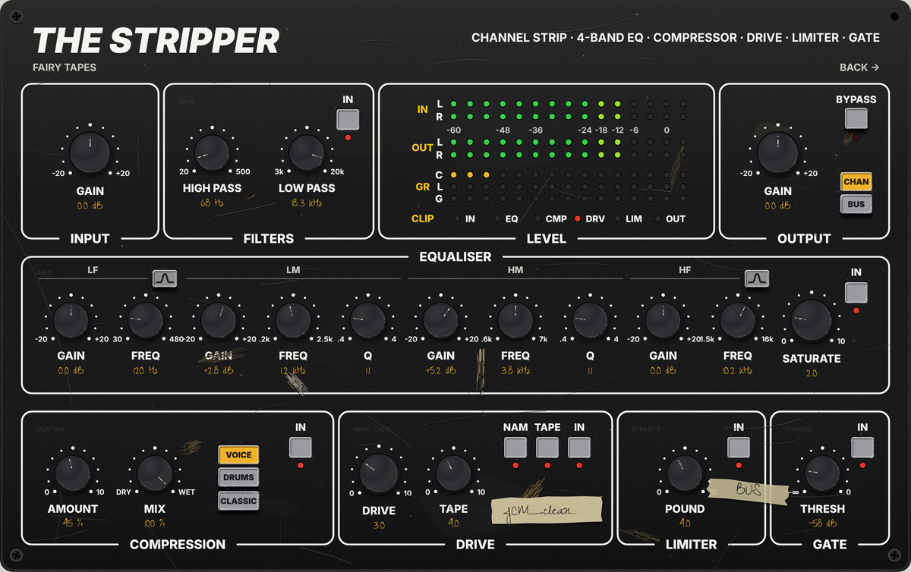
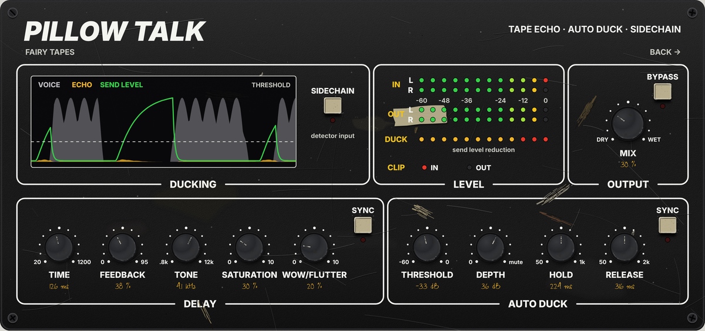
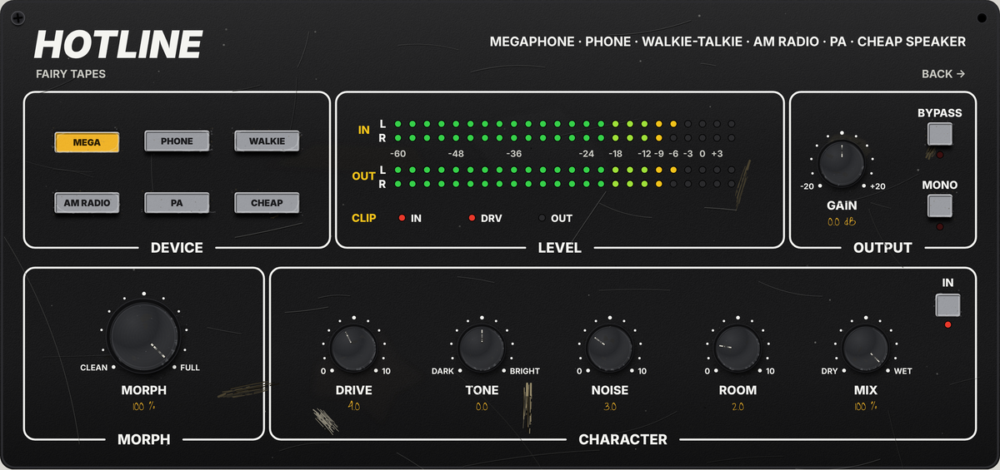
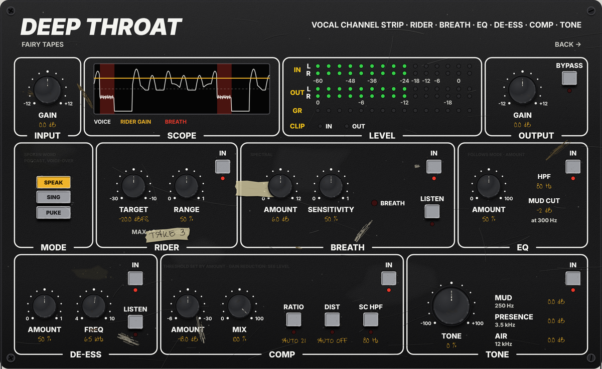
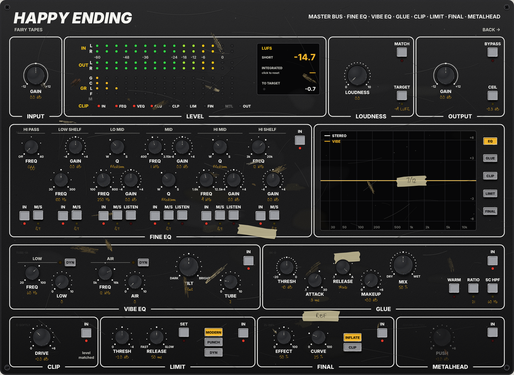
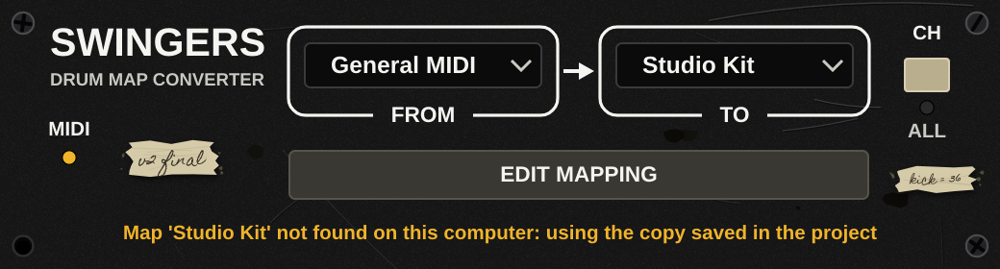
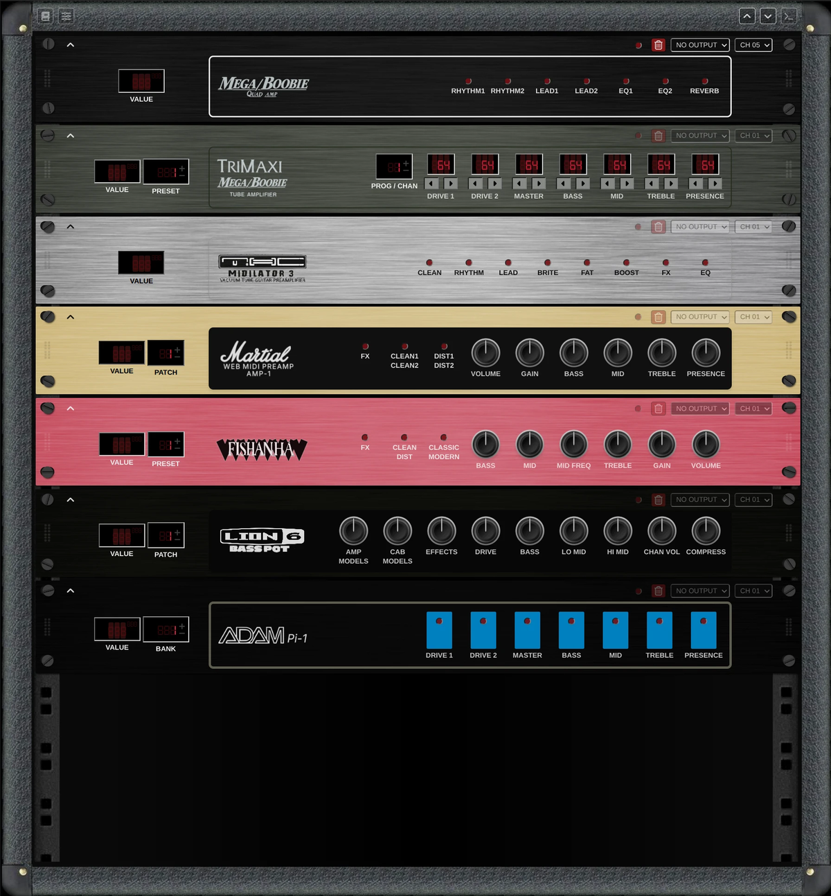

Open source tools for musicians and studios: audio plug-ins with an analog, hands-on feel, MIDI utilities and
controllers for outboard gear.

> **Work in progress.** The plug-ins and the tools are under active development. The Fairy Tapes images below are
> rendered from the HTML previews of the panels, not from the finished plug-ins; the Swingers image is rendered from the
> plug-in itself.

Created and maintained by [@swolley](https://github.com/swolley).

## Fairy Tapes

A suite of VST3 audio plug-ins with rack-style panels, worn hardware and handwritten tape. Repository:
[fairy-tapes](https://github.com/sweetspot-tools/fairy-tapes).

|  | Plug-in | What it is | License |
|---|---|---|---|
|  | [The Stripper](https://github.com/sweetspot-tools/fairy-tapes/tree/master/src/the-stripper) | Bus-oriented channel strip: filters, 4-band EQ, compression, drive with NAM or tape, limiter and gate | GPL-3.0 |
|  | [Pillow Talk](https://github.com/sweetspot-tools/fairy-tapes/tree/master/src/pillow-talk) | Tape echo that ducks its own return while the voice sings, so the tails land in the pauses | GPL-3.0 |
|  | [Hotline](https://github.com/sweetspot-tools/fairy-tapes/tree/master/src/hotline) | Device effects for voice and intros: megaphone, phone, walkie-talkie, AM radio, PA, cheap speaker | GPL-3.0 |
|  | [Deep Throat](https://github.com/sweetspot-tools/fairy-tapes/tree/master/src/deep-throat) | Vocal channel strip with Speak, Sing and Puke modes: rider, breath control, EQ, de-ess, compression and tone | GPL-3.0 |
|  | [Happy Ending](https://github.com/sweetspot-tools/fairy-tapes/tree/master/src/happy-ending) | Mastering chain for the master bus: fine EQ, vibe EQ, glue, clip, limit and final loudness, with LUFS metering (draft) | GPL-3.0 |
|  | [Doggy Style](https://github.com/sweetspot-tools/fairy-tapes/tree/master/src/doggystyle) | Dual-stage parallel (or serial/parallel switchable) compression — for drum groups (draft) | GPL-3.0 |

## MIDI tools

|  | Repository | What it is | License |
|---|---|---|---|
|  | [Swingers](https://github.com/sweetspot-tools/swingers) | Converts MIDI drum parts between drum maps through General MIDI, as a VST3, AU and CLAP plug-in and as a standalone app | AGPL-3.0 |
|  | [Turn me on](https://github.com/sweetspot-tools/turn-me-on) | Browser MIDI controller for outboard gear: build a virtual rack of devices and drive them over WebMIDI | MIT |

## Get involved

- Questions and ideas: open an issue in the repository concerned
- Bugs: open an issue in the repository concerned
- Security issues: never in a public issue, read the [security policy](https://github.com/sweetspot-tools/.github/blob/main/SECURITY.md)

Logos and names: see the [brand repository](https://github.com/sweetspot-tools/brand).
